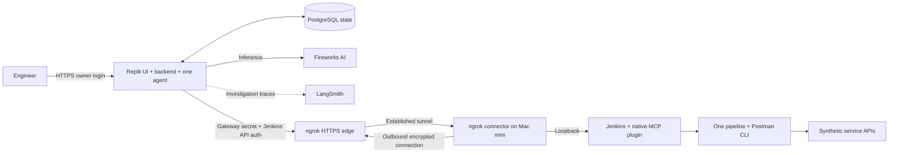

# Change Guardian — Week 3 Agentic AI Project

Post-change verification with **one Jenkins pipeline, native Jenkins MCP, and one bounded LangGraph agent**. All services, changes and enterprise-analyser context are synthetic.

Change Guardian helps an engineer review health/smoke/regression results, identify affected services that were not tested, investigate failures, and explicitly approve a diagnostic rerun. Jenkins owns the test outcome; the model supplies advisory findings.


## What is implemented

- One parameterized pipeline selects environment (`demo-dev` / `demo-qa`), services (`all` or a comma-separated subset), and suite (`health`, `smoke`, `regression`, `full`).
- Real Postman CLI execution, JUnit assertions, detailed JSON and collection/change provenance.
- Native Jenkins MCP reads for build metadata, test summaries and logs; authenticated REST downloads archived evidence.
- Deterministic verdict and coverage gaps. Untested services never become healthy because another service passed.
- One LangGraph reason/tool loop with three read-only investigation tools, persistent checkpoints, six-call and 120-second budgets. Selected-scope passing runs skip the model; coverage gaps remain visible.
- Exact-payload approval ledger: preview, approve/reject, atomic submission claim, request-ID reconciliation, and no automatic retry of uncertain writes.
- Owner-only dashboard, service/status navigation, and evidence-based failure details. Navigation filters the loaded run; it does not change execution scope or assign severity.

## Architecture



[C4 diagrams](outputs/Change-Guardian-C4-Architecture.md) · [Architecture decisions](docs/ARCHITECTURE.md) · [Setup](docs/SETUP.md) · [Validation](docs/EVALUATION.md) · [Reviewer walkthrough](docs/WALKTHROUGH.md)

The app is published at **https://change-guardian.replit.app/** on a Replit Reserved VM. Owner sign-in is required; credentials are supplied privately. The Mac mini simulates on-premises execution. No production organization systems are connected. ngrok is a trusted TLS-terminating intermediary; gateway and Jenkins authentication are independent.

## Quick start: no credentials required

Python 3.12 is recommended. The fixture demo uses the standard library:

```sh
python3 -m app.demo --scenario failure
python3 -m app.demo --scenario missing
python3 -m app.demo --scenario healthy
```

Fixture mode is explicitly labelled and makes no Jenkins, Postman or model calls. The healthy selected scope can still show an untested affected service.

For application tests and live integrations:

```sh
python3.12 -m venv .venv
.venv/bin/pip install -r requirements.lock.txt
.venv/bin/python -m unittest discover -s tests -v
cp .env.example .env
```

Set credentials locally as described in [SETUP](docs/SETUP.md), then run:

```sh
.venv/bin/python -m app.live --build <your-completed-build-number>
.venv/bin/python -m app.dashboard
```

Local dashboard: `http://127.0.0.1:8090/`. Build numbers belong to their Jenkins instance; sample IDs in validation notes are not portable. Cloud mode uses `requirements-cloud.txt` and `python -m app.cloud`, requires PostgreSQL and an owner password, and supports Replit Secrets. Never commit `.env`, runtime files, API tokens, or passwords.

## Observed results

| Acceptance run | Observed result |
|---|---|
| Mini build 2: dev / all / full | 18 assertions passed |
| Mini build 3: QA / accounts,payments / smoke | 3 assertions passed, 1 intentionally failed; positions NOT_TESTED |
| Mini build 5: approved payments diagnostic, parent 3 | Expected failure reproduced; request ID linked |
| LangSmith persisted trace, build 3 | 2 model spans + 3 read tools; 4,154 tokens; 19.38 seconds; no trace errors |
| Fireworks investigation from Replit, build 3 | AI_COMPLETE; 2 calls, 4,172 reported tokens, 15.65 seconds |
| Published app investigation, November 1 | AI_COMPLETE; 2 calls, 4,277 tokens, 22.32 seconds; health/login/Jenkins access verified |
| Application tests | 31 passing tests; model doubles are separate from live inference |

These are individual acceptance observations, not a statistical reliability benchmark. Provider dollar cost and p95 latency were not measured. [Full evaluation and limitations](docs/EVALUATION.md).

## Submission artifacts

- [Google Doc project report](https://docs.google.com/document/d/1V0xOeFbNsVCREB5sPoXMB27yfILO4J1_OZ3yt3sV4iQ/edit): overview, datasets, agent framework, coding prompts, iterations and learnings. The submission report is maintained only in Google Drive; grant reviewer access before submitting.
- [C4 context, containers, components and approval sequence](outputs/Change-Guardian-C4-Architecture.md).
- [Demo recording script](docs/DEMO_SCRIPT.md): 4:45 click-by-click walkthrough with 472 words of narration and a slow-run fallback.
- [Submission checklist](docs/SUBMISSION_CHECKLIST.md) and screenshots under `docs/screenshots/`.

The handout requires a Google Doc, a video of five minutes or less, and GitHub code. Screenshots are supporting evidence, not a replacement for the required video. The recording and final form submission remain the author's steps.

## Scope and limitations

No A2A, additional specialist agents, automated remediation, Slack/Jira writes, real ServiceNow integration, or severity classifier. The normalizer expects this synthetic collection's versioned test inventory. Human approval is an application state machine, not a claim that LangGraph `interrupt()` was implemented. Interactive checkpoint resume, production SSO, durable background job workers, and broader evaluation remain future work. LangSmith records the Replit investigation graph, model calls and read tools. Local tracing defaults off; see [observability](docs/OBSERVABILITY.md). Local SQLite and cloud PostgreSQL are alternate state backends.
