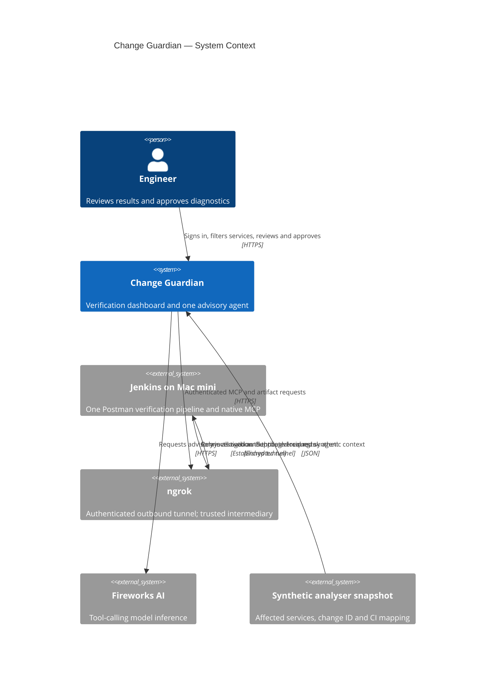
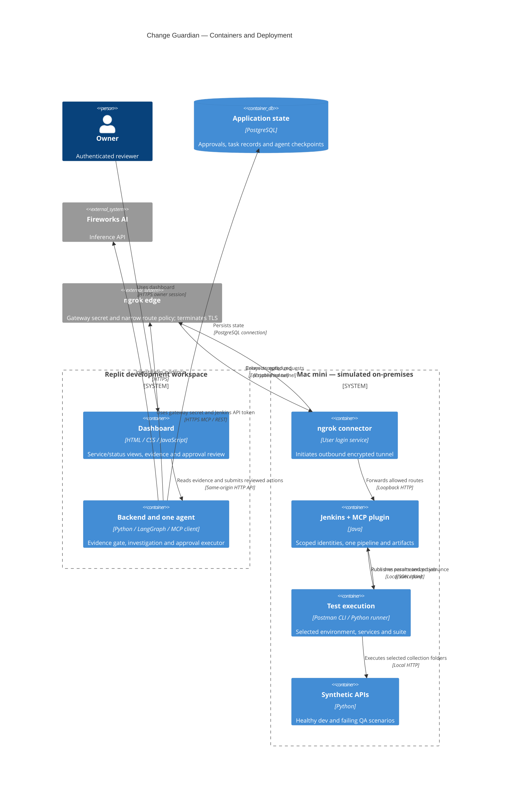
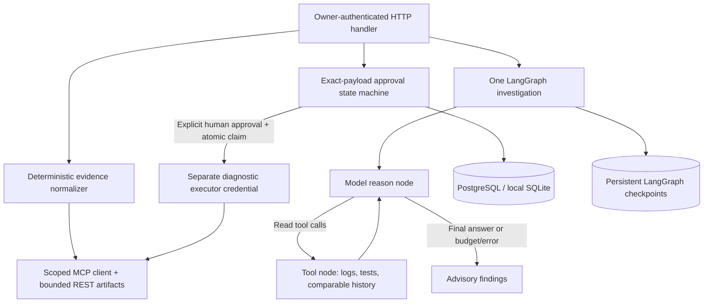

# Change Guardian — C4 architecture, as built

Validated October 31, 2026. Replit workspace preview + PostgreSQL + authenticated ngrok + Mac mini execution. An always-on Replit deployment has not been published. Historical Cloudflare plans are superseded.

## Level 1 — system context



## Level 2 — containers



## Level 3 — backend components



Human review is implemented outside the model loop. The model never receives triggerBuild. This is a single-agent design; tool nodes and the approval executor are not additional agents.

## Diagnostic sequence

```mermaid
sequenceDiagram
  actor Owner
  participant App as Replit backend
  participant DB as PostgreSQL
  participant Edge as ngrok
  participant Jenkins as Mac mini Jenkins MCP
  Owner->>App: Prepare selected diagnostic
  App->>DB: Persist exact payload and parent evidence digest
  App-->>Owner: Show scope and reason
  Owner->>App: Approve exact digest
  App->>DB: Atomically claim PENDING as SUBMITTING
  App->>Edge: triggerBuild with gateway + executor credentials
  Note over Edge,Jenkins: Outbound mini tunnel already established
  Edge->>Jenkins: Allowed MCP request; Jenkins checks permissions
  Jenkins-->>App: Queue reference
  App->>DB: Save queue/request ID
  App->>Edge: Read registered-job status
  Edge->>Jenkins: Authenticated read
  Jenkins-->>App: Diagnostic build and parent linkage
  App-->>Owner: Diagnostic outcome; original verdict preserved
```

Uncertain submissions are marked UNKNOWN and only reconciled. The edge, app authentication and Jenkins authorization are independent boundaries. No browser receives gateway, Jenkins or model keys.
